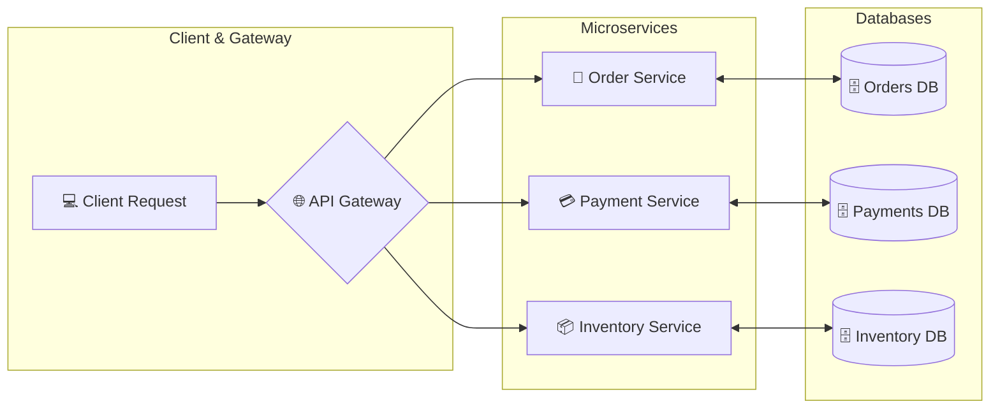
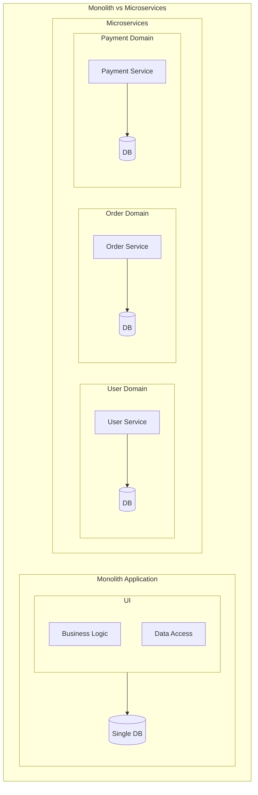
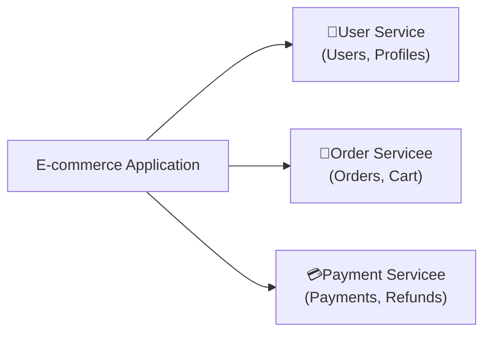
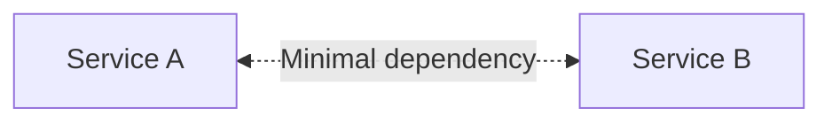
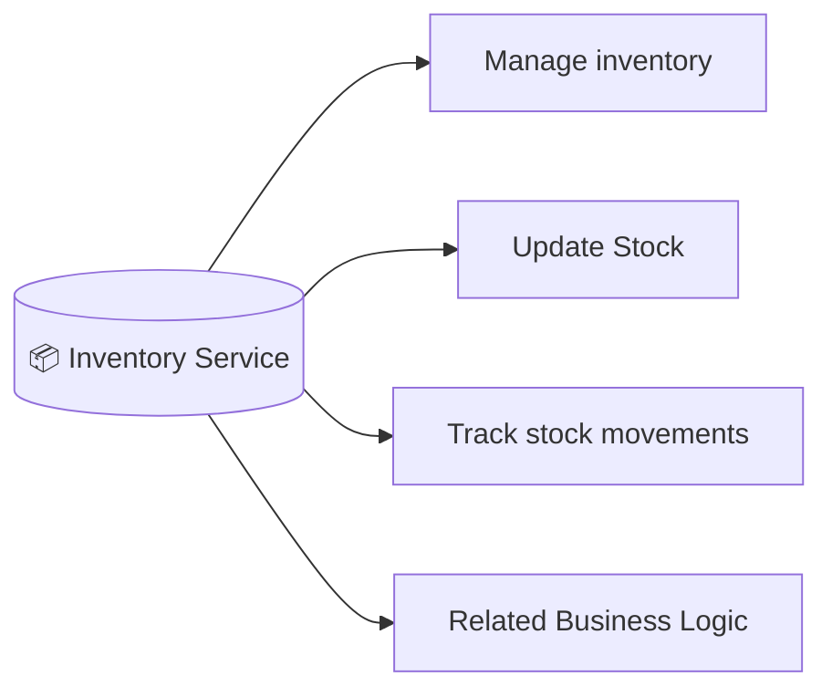
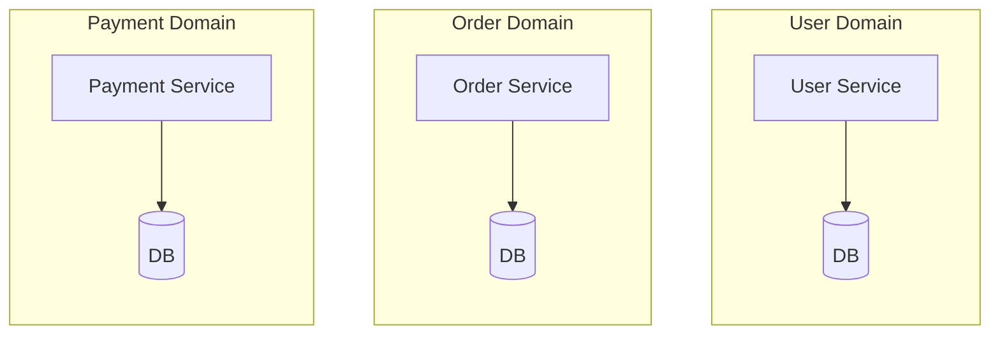
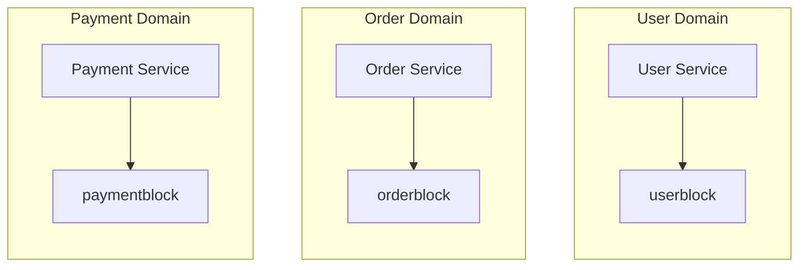
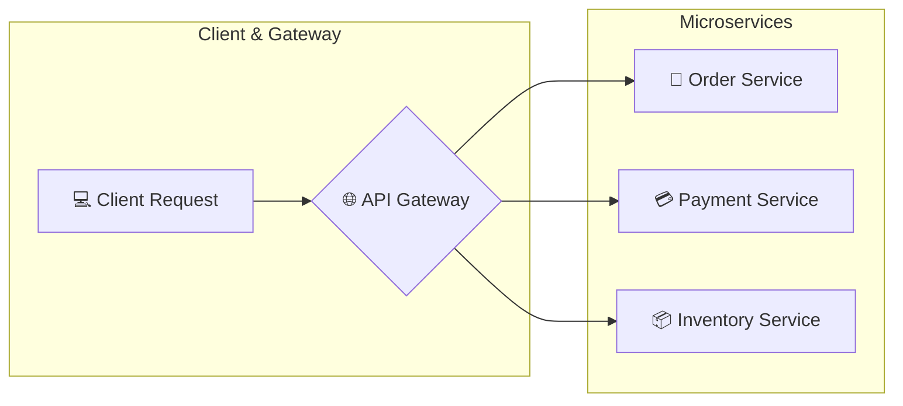

# Basic Questions to ask before building Microservice



## Microservices Architecture Fundamentals

### 1. Monolith vs Microservices

Understand the architectural trade-offs



### 2. Service Boundaries

How do you decide what belongs to each service?



### 3. Loose Coupling

How do you minimize dependencies between services?



### 4. High Cohesion

Why should each service focus on a closely related set of responsibilities?



### 5. Database per Service

Why would each service own its data?



### 6. Independent Deployment & Scaling

Can you deploy and  scale one service without affecting the others?



### 7. Distributed Monolith

What happens when separate services are still tightly dependant on each other?

```mermaid
graph LR
    srca[Service A] <-->[Tight coupling] srcb[Service B]
    srca[Service A] <-->❌ srcb[Service B]
```

### 💡Key insight

Splitting an application into multiple servicees **doesnt automatically** make it a good microservices architecture.
***Good service boundaries matter more than the number of services.***

## API Gateway & Service Discovery

### 1. API Gateway

How does a single entry point route requests to multiple services?



- Handles routing
- Authentication & Authorization
- Rate limiting
- Request/Response transformation

### 2. Service Registry

Where do services register their available instances?

```mermaid
graph LR 
    srcRegDB[Service Registry<br>(e.g. Eureka, Consol)] --> ordSrc[Order Services<br>10.0.1.5:8080]
    srcRegDB[Service Registry<br>(e.g. Eureka, Consol)] --> paySrc[Payment Services<br>10.0.2.8:8080]
    srcRegDB[Service Registry<br>(e.g. Eureka, Consol)] --> invSrc[Inventory Services<br>10.0.3.10:8080]
```

- Services register themselves on startup
- Registry keeps track of available instances
- Instances can be added/removed dynamically

### 3. Service Discovery

How does one service find another without hardcoding its address?

```mermaid
graph LR
    ordSrc[Order Service] -->[1. Ask for payment Service] srcRegDb[Service Registry]
    subgraph paySrcInst[Payment Services Instances]
    direction LR
        ordIp[10.0.2.8:8080]
        payIp[10.0.2.9:8080]
        invIp[10.0.2.10:8080]
    end
    ordSrc[Order Service] <-->[3. Call one of the instances (via load balancer)] paySrcInst[Payment Services Instances]
    paySrcInst[Payment Services Instances] -->[2. Returns available instances] srcRegDb[Service Registry]
```
