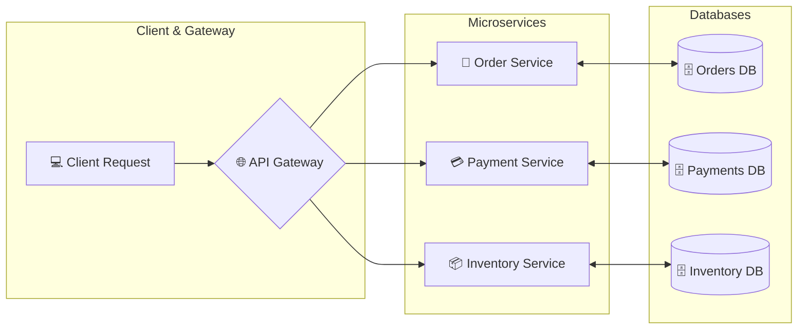
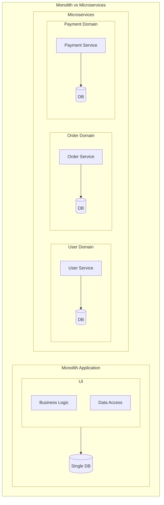
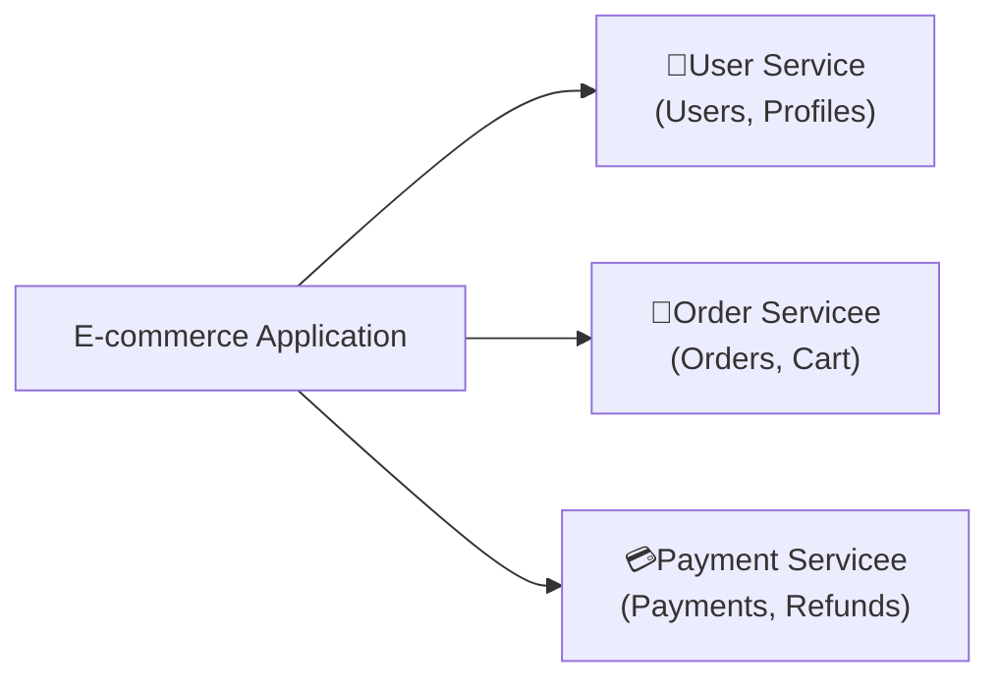
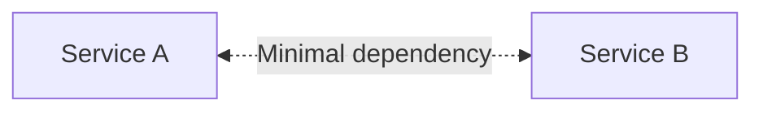
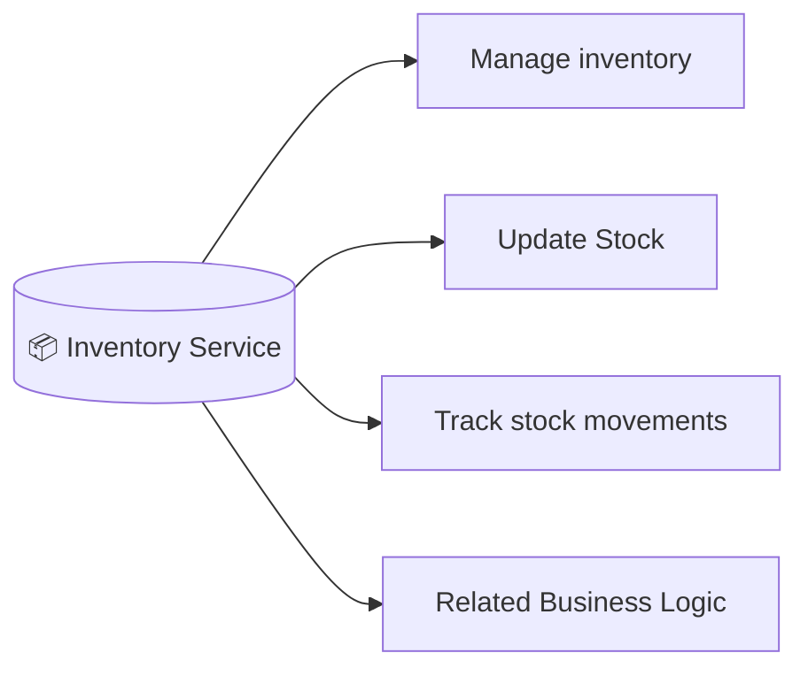
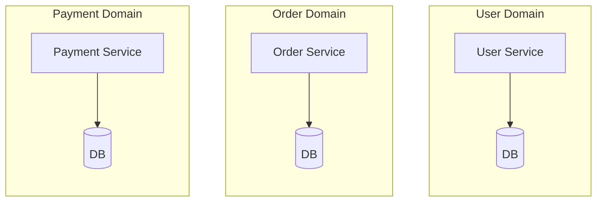
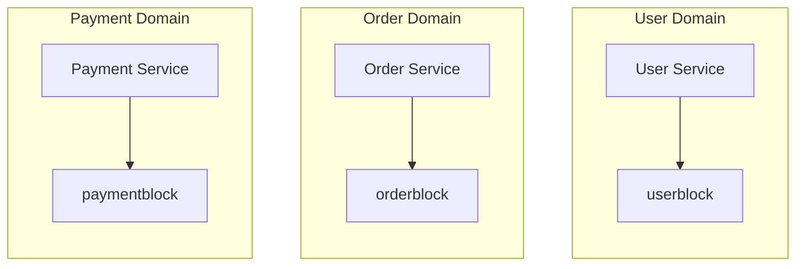

# Basic Questions to ask before building Microservice

## Microservices Architecture Fundamentals

### 1. Monolith vs Microservices

Understand the architectural trade-offs

### 2. Service Boundaries

How do you decide what belongs to each service?

### 3. Loose Coupling

How do you minimize dependencies between services?

### 4. High Cohesion

Why should each service focus on a closely related set of responsibilities?

### 5. Database per Service

Why would each service own its data?

### 6. Independent Deployment & Scaling

Can you deploy and  scale one service without affecting the others?

