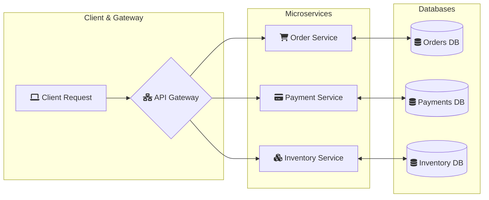
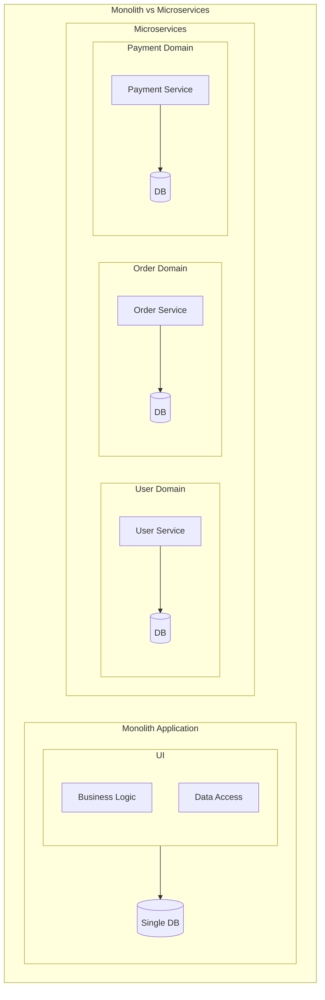
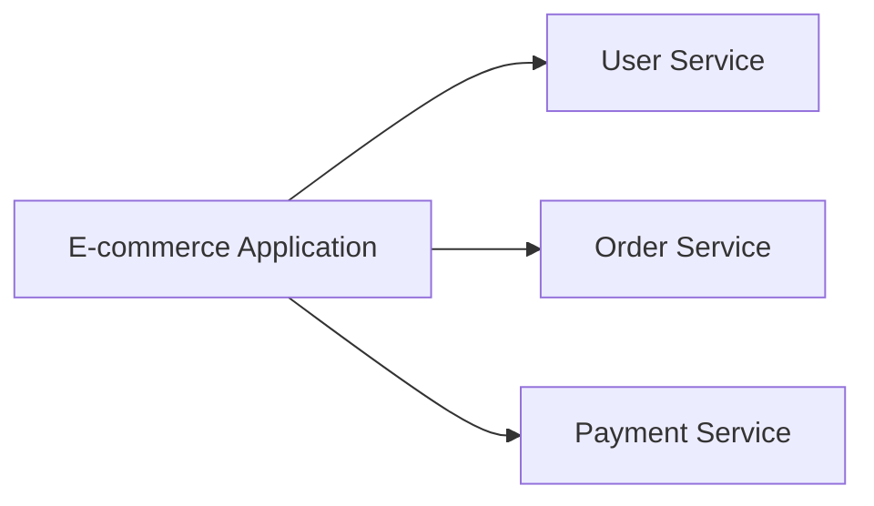

# Basic Questions to ask before building Microservice

## Microservices Architecture Fundamentals

### 1. Monolith vs Microservices

Understand the architectural trade-offs

### 2. Service Boundaries

How do you decide what belongs to each service?

